Gallery
=======

Animations made with SPICE and the ``mjablonska/TPayne-spice-harps-interp`` v1.2.0 emulator
(the emulator of the paper, see :doc:`aemu_integration`). Every spectrum and magnitude below
is synthesised element by element over the stellar surface, with the emulator's own
angle-dependent specific intensities and per-element occlusion, and (except in the two
light-curve gradient examples) per-element Doppler shifts.

Each animation has a script in
`tutorial/showcase/ <https://github.com/maja-jablonska/spice/tree/main/tutorial/showcase>`_.
The scripts write their data to ``data.npz`` and render it separately
(``--render-only`` restyles a figure without JAX). The full runs used a GPU; every script
also takes ``--quick`` for a small CPU test.

.. contents:: On this page
   :local:
   :depth: 1

Rotational broadening
---------------------

A Sun-like star spun up from 0 to 100 km/s and back. Left: the visible disc, coloured by
line-of-sight velocity. Right: the Mg b triplet broadening as the star speeds up, with the
non-rotating spectrum in grey. Script: ``s01_rotation.py``.

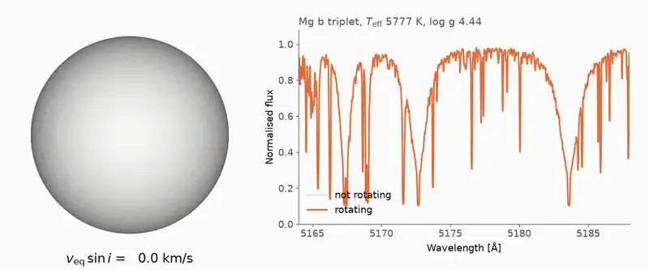

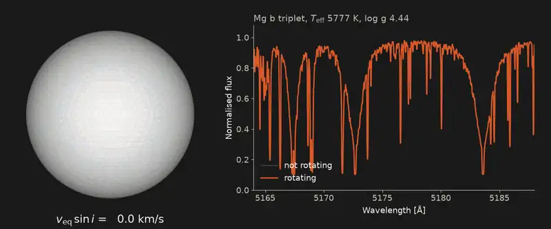

Starspots and line-profile variations
-------------------------------------

Two cool spots on a K dwarf (inclination 60°, equatorial velocity 35 km/s). Each spot
removes light from one velocity bin of the Fe I 6173 Å line, so a bump travels across the
profile as the star turns. The right panel builds up the residual dynamic spectrum: Doppler
imaging run forwards. Script: ``s02_doppler_imaging.py``.

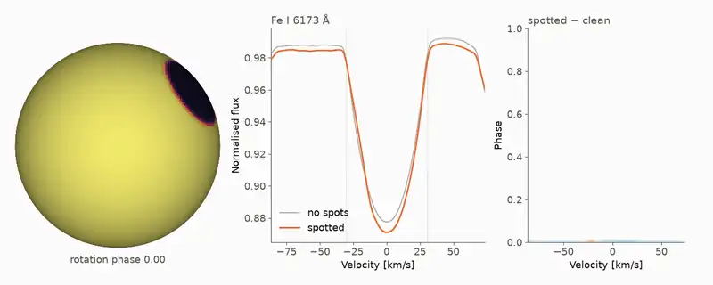

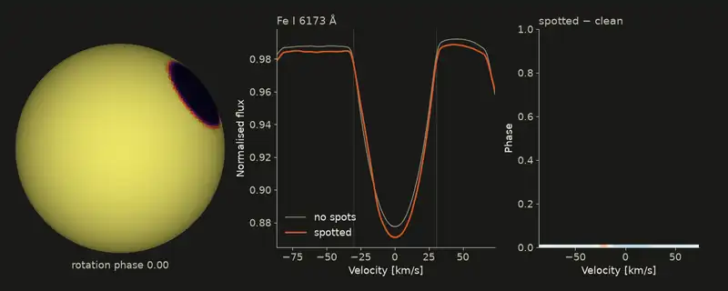

An eclipsing binary
-------------------

An F + K dwarf pair (P = 2.5 d, i = 87°) with synchronised, aligned spins. Top: both stars
on the sky, coloured by spin velocity (each star's orbital motion removed), with each
surface element's occlusion resolved. Bottom left: the Strömgren y light curve. Bottom right: the composite Mg b
spectrum, where the two sets of lines split and merge over the orbit; the brighter
F star's lines dominate the composite. Script: ``s03_eclipse.py``.

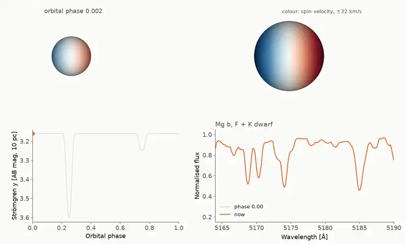

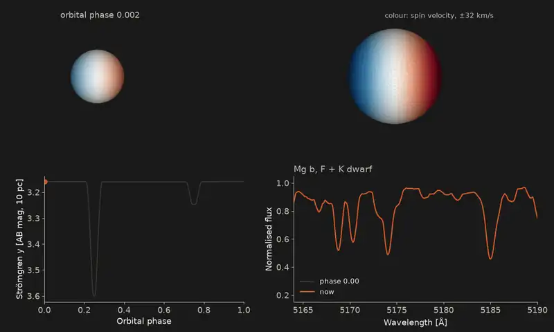

A transiting planet: the Rossiter-McLaughlin effect
---------------------------------------------------

A hot Jupiter (R = 0.13 R☉) crossing a rotating F dwarf (v_eq = 30 km/s), on an aligned
orbit and on one with a projected obliquity of 60°. The planet hides first the
approaching and then the receding half of the star, so the measured radial velocity jumps
off the Keplerian curve and a "Doppler shadow" crosses the line profile. When the orbit is
misaligned, the planet covers mostly one half and the anomaly becomes asymmetric. Radial
velocities come from a template fit over the Mg b window; the planet's own light is
ignored. Script: ``s10_rossiter_mclaughlin.py``.

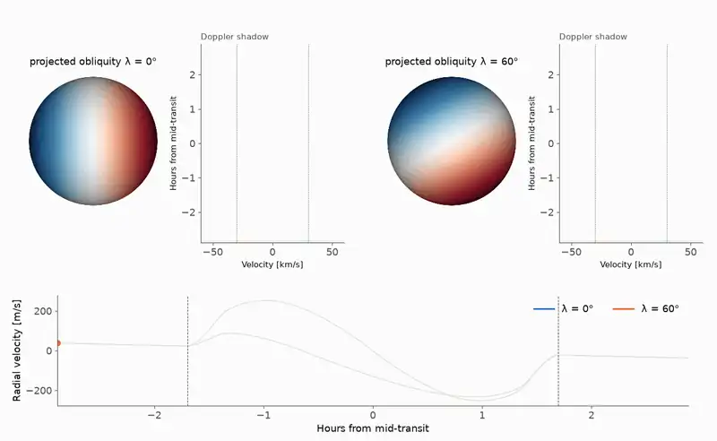

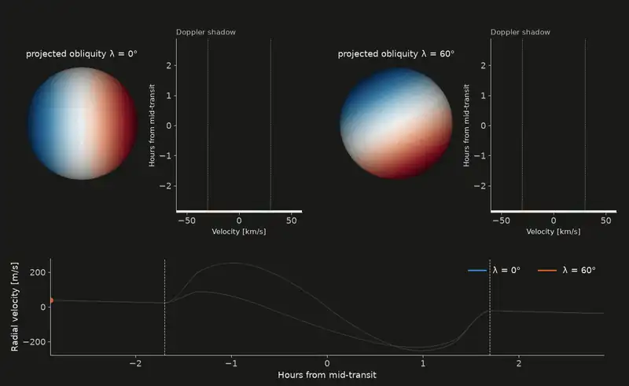

δ Cephei
--------

The SPIPS model of δ Cep (radius, Teff and dynamic log g over its 5.37 d cycle), with
the microturbulence of Luck (2018), drives a radially pulsating mesh. Left: the disc at true relative size,
coloured by Teff. Middle: an Fe I line shifting and turning asymmetric through the cycle.
Right: radius, Teff and the line's centroid velocity. There is no rotation and no
macroturbulence, so every change in the line comes from the pulsation.
Script: ``s04_cepheid.py``.

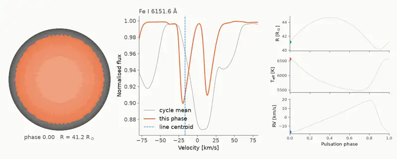

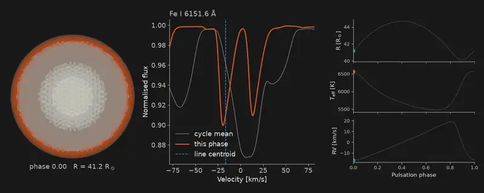

Solar-like oscillations
-----------------------

A Sun carrying seven low-degree p modes (l = 0-5, periods 4.6-5.7 min). Left: the surface
velocity pattern beating as the modes drift in and out of phase. Middle: the Fe I 6173 Å
line minus its time average. Right: the disc-integrated radial velocity. Low-degree modes
survive disc integration and high-degree ones mostly cancel, which is why Sun-as-a-star
data see only l ≤ 3. The local velocities are solar-like, but all the power sits in seven
modes, so the integrated RV (~100 m/s) is about 50 times the Sun's.
Script: ``s11_solar_oscillations.py``.

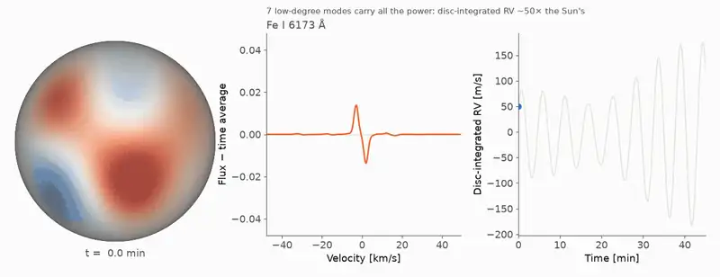

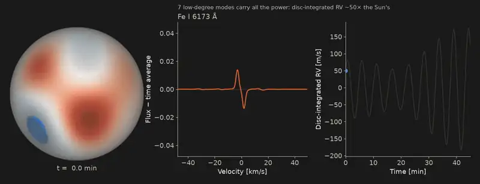

Gradients through an eclipse
----------------------------

SPICE is written in JAX, so every model output can be differentiated. These are the
exact (forward-mode autodiff) derivatives of the Strömgren y magnitude of the eclipsing
binary above, with respect to both radii, the inclination and the secondary's Teff, phase
by phase through the primary eclipse. They show where in the light curve each parameter
carries information; a finite-difference code would need two extra light curves per
parameter. Script: ``s05_gradients.py``, which also checks a few phases against central
finite differences.

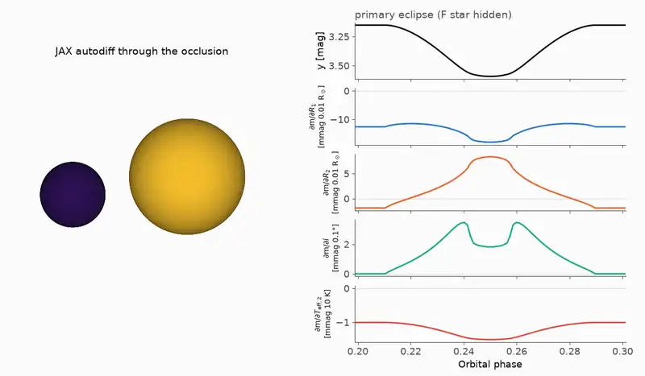

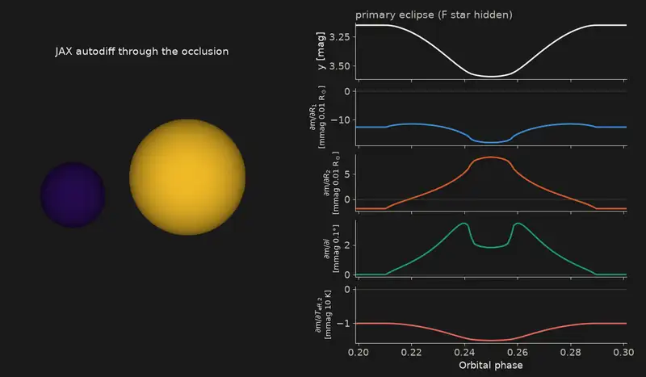

A gradient-based fit
--------------------

Synthetic Strömgren y photometry of the same binary (3 mmag noise, both eclipses) is fitted
from a deliberately wrong start with Adam on exact SPICE gradients (R1, R2, inclination,
Teff2; the zero point is solved analytically at every step). The model light curve snaps
onto the data while the parameters converge close to the true values. The data are synthetic;
this shows the machinery, not a published fit. Script: ``s06_fit_loop.py``.

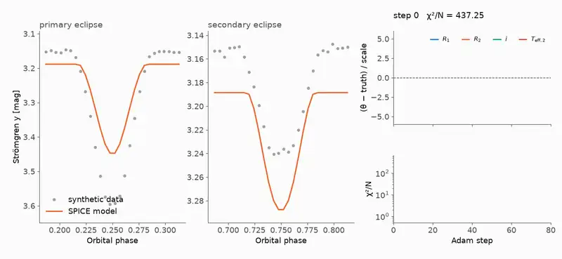

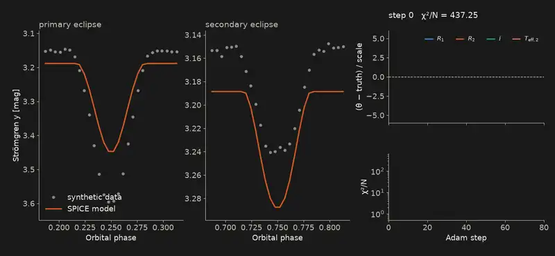
