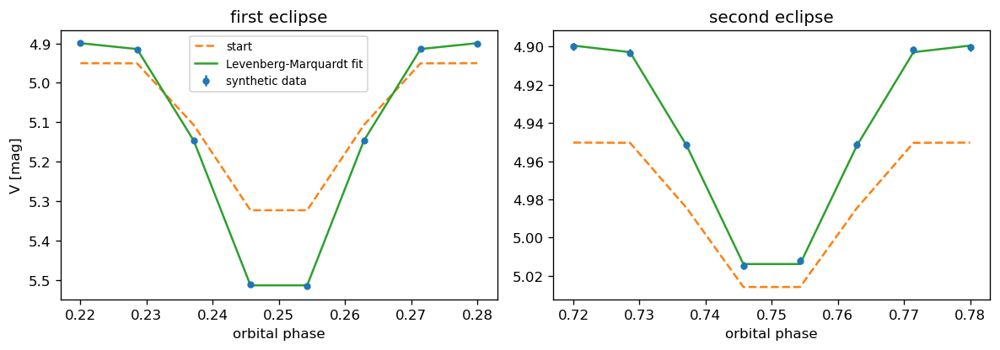
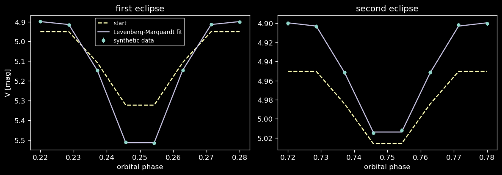

Gradients and Fitting
=====================

SPICE is written in JAX, so a spectrum, a magnitude or a whole light curve can
be differentiated with respect to the stellar and orbital parameters that
produced it: :func:`jax.grad`, :func:`jax.jvp` and :func:`jax.jacfwd` work
through mesh construction, rotation, occlusion and spectral synthesis. This page
shows the basic patterns, the few places where tracing stops, and a fit of an
eclipsing-binary light curve on exact derivatives.

.. note::

   Every code snippet and number on this page comes from the companion notebook
   `tutorial/docs_examples/gradients_examples.ipynb <https://github.com/maja-jablonska/spice/blob/main/tutorial/docs_examples/gradients_examples.ipynb>`_,
   run on a laptop CPU with ``JAX_ENABLE_X64=1`` (64-bit precision is not needed
   for gradients, but the finite-difference checks below are cleaner with it).
   The gallery's :ref:`gradient sweep <gallery-gradients>` and
   :ref:`fit animation <gallery-fit>` use the same machinery on the paper's emulator.

A magnitude and its derivative
------------------------------

Write the quantity as a function of the parameter and hand it to JAX. Here the
Johnson V magnitude of a Sun-like blackbody star as a function of its
effective temperature:

.. code-block:: python

    import jax
    import jax.numpy as jnp
    from spice.models import IcosphereModel
    from spice.models.mesh_transform import update_parameter
    from spice.spectrum import Blackbody, simulate_observed_flux, AB_passband_luminosity
    from spice.spectrum.filter import JohnsonCousinsV

    bb = Blackbody()
    star = IcosphereModel.construct(1000, 1., 1., bb.solar_parameters, bb.parameter_names)
    wl = jnp.linspace(4500., 7000., 500)
    V = JohnsonCousinsV()

    def v_mag(teff):
        m = update_parameter(star, 'Teff', jnp.full(star.parameters.shape[0], teff),
                             bb.parameter_names)
        flux = simulate_observed_flux(bb.intensity, m, jnp.log10(wl),
                                      disable_doppler_shift=True)[:, 0]
        return AB_passband_luminosity(V, wl, flux)

    mag, dmag = jax.value_and_grad(v_mag)(5777.)
    # V = 4.8668 mag, dV/dTeff = -8.6262e-04 mag/K (finite difference -8.6262e-04)

Pass ``disable_doppler_shift=True`` for photometry: the Doppler resampling of
each element's spectrum does not change a broad-band magnitude, and skipping it
makes both the value and its derivative cheaper.

A line profile and its Jacobian
-------------------------------

For a vector output, :func:`jax.jacfwd` returns one derivative per output
element. The continuum-normalised profile of a Gaussian line on a star rotating
at 20 km/s, differentiated with respect to the rotation velocity:

.. code-block:: python

    from spice.models.mesh_transform import add_rotation, evaluate_rotation
    from spice.spectrum import GaussianLineEmulator

    gl = GaussianLineEmulator(line_centers=[5500.], line_widths=[0.3], line_depths=[0.5])
    star_gl = IcosphereModel.construct(1000, 1., 1., gl.to_parameters(), gl.parameter_names)
    wl_line = jnp.linspace(5498., 5502., 200)

    def normalised_profile(vrot):
        m = evaluate_rotation(add_rotation(star_gl, vrot), 0.)
        f = simulate_observed_flux(gl.intensity, m, jnp.log10(wl_line))
        return f[:, 0] / f[:, 1]

    J = jax.jacfwd(normalised_profile)(20.)   # shape (200,): one value per wavelength
    # line-centre sensitivity +6.50e-03 per km/s: faster rotation fills in the core

Forward or reverse mode
~~~~~~~~~~~~~~~~~~~~~~~

:func:`jax.jacfwd` and :func:`jax.jvp` (forward mode) cost about one extra
model evaluation per *input* parameter. :func:`jax.grad` (reverse mode) costs
about one extra evaluation per *output* but has to keep the intermediate
values of the whole computation for the backward pass, and for synthesis that
means per-element spectra across the mesh, plus the occlusion geometry for a
binary. For the usual case of a handful of physical parameters, forward mode
is the cheaper choice and uses far less memory; the showcase light-curve code
(``tutorial/showcase/difflc.py``) uses one :func:`jax.jvp` per parameter for
exactly this reason, because reverse mode through the occlusion ran out of GPU
memory on fine meshes. Reverse mode pays off for a scalar loss of many
parameters, e.g. a map of per-element abundances.

A binary light curve
--------------------

Radii and inclination enter through the mesh and the orbit, so the meshes are
built *inside* the differentiated function. Two things must stay concrete
(ordinary Python numbers) while the rest is traced:

- the mesh resolution: ``IcosphereModel.construct`` needs a concrete vertex
  count (``N_VERT`` below), which fixes all array shapes;
- the occlusion neighbour counts: :meth:`Binary.from_bodies
  <spice.models.binary.Binary.from_bodies>` derives them from the radii by
  default, which fails for traced radii. Size them once at concrete values,
  with headroom for the radii a fit may explore, and pass them explicitly.

.. code-block:: python

    from spice.models import Binary, find_binary_eclipses
    from spice.models.binary import add_orbit, evaluate_orbit

    N_VERT = 300
    P = 0.01                                          # years
    p1 = bb.to_parameters(dict(Teff=6000.))
    p2 = bb.to_parameters(dict(Teff=4500.))
    wl = jnp.linspace(4500., 7000., 300)

    # Size the occlusion neighbour search once, at concrete radii
    ref = Binary.from_bodies(IcosphereModel.construct(N_VERT, 1.0, 1.0, p1, bb.parameter_names),
                             IcosphereModel.construct(N_VERT, 0.8, 0.8, p2, bb.parameter_names))
    NN = (int(1.5 * ref.n_neighbours1) + 1, int(1.5 * ref.n_neighbours2) + 1)

    def make_binary(theta):
        R1, R2, incl_deg = theta
        b1 = IcosphereModel.construct(N_VERT, R1, 1.0, p1, bb.parameter_names)
        b2 = IcosphereModel.construct(N_VERT, R2, 0.8, p2, bb.parameter_names)
        return add_orbit(Binary.from_bodies(b1, b2, *NN), P, 0., 0., jnp.deg2rad(incl_deg),
                         0., 0., 0., 0., 0., 100)

    def v_mag_binary(theta, t):
        m1, m2 = evaluate_orbit(make_binary(theta), t)
        f = sum(simulate_observed_flux(bb.intensity, m, jnp.log10(wl), disable_doppler_shift=True)[:, 0]
                for m in (m1, m2))
        return AB_passband_luminosity(V, wl, f)

    theta0 = jnp.array([1.0, 0.8, 88.0])             # R1, R2 [R_sun], inclination [deg]
    eclipses = find_binary_eclipses(make_binary(theta0))
    t = 0.5 * (eclipses[0]['T1'] + eclipses[0]['mid'])  # half-way into the first eclipse
    J = jax.jacfwd(v_mag_binary)(theta0, t)

Against central finite differences, half-way into the first eclipse:

.. list-table::
   :header-rows: 1

   * - Derivative of V
     - autodiff
     - finite difference
   * - :math:`\partial V / \partial R_1` [mag/R☉]
     - −1.83212
     - −1.83211
   * - :math:`\partial V / \partial R_2` [mag/R☉]
     - +0.29024
     - +0.29024
   * - :math:`\partial V / \partial i` [mag/deg]
     - +0.05216
     - +0.05216

The derivatives agree to the precision of the finite differences. At exact
mid-eclipse of this coarse 320-face mesh the two differ by up to 0.1 %
(e.g. −2.6170 against −2.6176 for :math:`R_1`): the visible area of a
triangulated mesh is only piecewise smooth in the radii, so a finite
difference across a step straddles mesh features.

Things that do not trace
~~~~~~~~~~~~~~~~~~~~~~~~

- **No** :func:`jax.jit` **around a binary model or a magnitude.**
  :func:`~spice.models.binary.evaluate_orbit` reads the neighbour counts stored
  on the binary as Python integers, which fails when the binary is built inside
  the jitted function (``ConcretizationTypeError``), and the passband functions
  (:func:`~spice.spectrum.spectrum.AB_passband_luminosity` and friends) run a
  NumPy wavelength-coverage check that cannot see traced values
  (``TracerArrayConversionError``). A jitted function returning a *spectrum*
  of a single star works. The synthesis and orbit functions are compiled
  internally, so an outer ``jit`` would gain little; differentiate without it.
- **Traced radii in** ``Binary.from_bodies`` **without explicit neighbour
  counts** also raise ``ConcretizationTypeError``; pass ``n_neighbours1`` and
  ``n_neighbours2`` as above.
- **Mesh resolution and chunk sizes** are shape parameters, not differentiable
  inputs.

A gradient-based fit
--------------------

Sixteen synthetic V magnitudes through both eclipses of the binary above
(truth :math:`R_1 = 1.0`, :math:`R_2 = 0.8`, :math:`i = 88^\circ`; 2 mmag
noise; an unknown zero point of 0.37 mag), fitted from a deliberately wrong
start. For a least-squares problem the exact Jacobian makes a
Levenberg-Marquardt loop natural, and its inverse Hessian gives the
uncertainties. The zero point is solved analytically at every step by
centring the residuals and the Jacobian:

.. code-block:: python

    truth = jnp.array([1.0, 0.8, 88.0])
    times = np.concatenate([np.linspace(0.22, 0.28, 8), np.linspace(0.72, 0.78, 8)]) * P
    sigma = 0.002
    rng = np.random.default_rng(1)
    data = (jnp.stack([v_mag_binary(truth, t) for t in times])
            + rng.normal(0., sigma, len(times)) + 0.37)

    jac = jax.jacfwd(v_mag_binary)

    def residuals(theta):
        """Residuals and Jacobian with the zero point solved analytically."""
        model = jnp.stack([v_mag_binary(theta, t) for t in times])
        J = jnp.stack([jac(theta, t) for t in times])
        r = data - model
        return r - r.mean(), J - J.mean(axis=0), float(r.mean())

    theta = jnp.array([1.06, 0.72, 86.8])             # deliberately wrong start
    lam = 1e-2
    rc, Jc, zp = residuals(theta)
    chi2 = float(jnp.sum((rc / sigma) ** 2))
    for it in range(6):
        A = Jc.T @ Jc
        step = jnp.linalg.solve(A + lam * jnp.diag(jnp.diag(A)), Jc.T @ rc)
        rc_new, Jc_new, zp_new = residuals(theta + step)
        chi2_new = float(jnp.sum((rc_new / sigma) ** 2))
        if chi2_new < chi2:                           # accept
            theta, rc, Jc, zp, chi2, lam = theta + step, rc_new, Jc_new, zp_new, chi2_new, lam / 3
        else:                                         # reject and damp
            lam *= 5

    errors = np.sqrt(np.diag(np.linalg.inv(np.asarray(Jc.T @ Jc) / sigma ** 2)))

The fit converges in three iterations (:math:`\chi^2/N` 1491 at the start,
143, 0.52, 0.34, then 0.33) to

.. list-table::
   :header-rows: 1

   * - Parameter
     - Fit
     - Truth
   * - :math:`R_1` [R☉]
     - 0.993 ± 0.026
     - 1.0
   * - :math:`R_2` [R☉]
     - 0.811 ± 0.034
     - 0.8
   * - :math:`i` [deg]
     - 87.89 ± 0.33
     - 88.0
   * - zero point [mag]
     - 0.362
     - 0.37

The run takes about a minute on a laptop CPU (each iteration evaluates 16
magnitudes and their Jacobians on 320-face meshes).

The same gradient drives any first-order optimiser. With
`optax <https://optax.readthedocs.io>`_, optimising scaled parameters so that
one unit is a sensible step in each:

.. code-block:: python

    import optax

    scale = jnp.array([0.05, 0.05, 1.0])
    start = jnp.array([1.06, 0.72, 86.8])
    z = jnp.zeros(3)
    opt = optax.adam(0.15)
    state = opt.init(z)
    for step in range(20):
        rc_k, Jc_k, _ = residuals(start + z * scale)
        grad_z = -(rc_k / sigma ** 2) @ Jc_k * scale  # gradient of chi2 / 2
        updates, state = opt.update(grad_z, state)
        z = optax.apply_updates(z, updates)

Here :math:`\chi^2/N` falls from 1491 to 333 after 5 steps and 12 after 10,
then rises again to 170 and 53 at steps 15 and 20.

Adam needs many more model evaluations than Levenberg-Marquardt on a
three-parameter least-squares problem, and with strongly correlated parameters
(the radii and the zero point here) a fixed learning rate makes it oscillate
along the valley; it is the
tool for losses that are not sums of squares, or for many parameters. The
gallery's fit animation (``tutorial/showcase/s06_fit_loop.py``) runs Adam with
a cosine-decaying learning rate for 80 steps.

Notes
-----

- Keep the mesh resolution, wavelength grid and chunk sizes fixed across a
  fit: they set array shapes, and changing them recompiles. See
  :doc:`performance`.
- MCMC samplers that :func:`jax.jit` the log-density (e.g. NUTS in NumPyro)
  run into the outer-``jit`` restriction above when the likelihood involves a
  binary or a magnitude.
