Creating a Mesh Model
===========================

The SPICE library provides functionality to create and manipulate icosphere models, which are useful for representing stellar surfaces. Here's how you can create and modify an icosphere model:

.. note::

   The companion notebook contains mesh and plotting examples:
   `tutorial/docs_examples/mesh_examples.ipynb <https://github.com/maja-jablonska/spice/blob/main/tutorial/docs_examples/mesh_examples.ipynb>`_;
   running it end-to-end regenerates all figures below.

Basic Icosphere Creation
------------------------

To create a basic icosphere model, you can use the `IcosphereModel.construct()` method:

.. code-block:: python

    from spice.models import IcosphereModel
    from spice.spectrum import Blackbody

    # Initialize a Blackbody model (for spectrum calculation)
    bb = Blackbody()

    # Create an icosphere model
    m = IcosphereModel.construct(
        1000,  # Resolution request; rounded to a refinement level
        1.,     # Radius in solar radii
        1.,     # Mass in solar masses
        bb.to_parameters(),  # Parameters for the spectrum model
        bb.parameter_names   # Names of the parameters used to match between overridable parameters and mesh parameters
    )

``n_vertices`` selects a discrete refinement level; inspect
``m.vertices.shape[0]`` and ``m.faces.shape[0]`` for the actual array sizes.
The number of triangular surface elements at subdivision level ``L`` is:

.. math::
    N_{\mathrm{faces}} = 20 \times 4^L

Here ``L = 0`` is the initial 20-face icosahedron. The values below count
faces, each of which has one row of stellar parameters.

The following table shows the number of faces for different refinement levels:

.. list-table:: Icosphere Refinement Levels
   :header-rows: 1
   :widths: 25 25

   * - Refinement Level
     - Number of Faces
   * - 1
     - 80
   * - 2
     - 320
   * - 3
     - 1280
   * - 4
     - 5120
   * - 5
     - 20480

The mesh stores parameters for each face. A scalar (one parameter) or
1-D list/array is broadcast to all faces; a 2-D array provides one row per
face. Inputs are converted to the active JAX floating-point dtype.
The parameter names and their order must match the spectrum model.
In the case of the Blackbody model, the parameters are the temperature, but more complex models contain more parameters such as logg, individual abundances, etc.
In principle, any model can be used for the spectrum, and the model can contain any number of parameters - as long as the parameters are defined in the spectrum model.

Some parameters may be fixed for the mesh, and some may be overridable - for example, logg depends on the mass and radius, so it may be calculated automatically from the parameters in the case of
distorted models, e.g. pulsation or rotation.

Adding Rotation
---------------

SPICE has a functional API, which means that all transformations are done using functions that return a new model instance.

You can add rotation to your model using the `add_rotation()` function:

.. code-block:: python

    from spice.models.mesh_transform import add_rotation, evaluate_rotation
    import jax.numpy as jnp

    # Add rotation to the model
    rm = add_rotation(
        m, # Model instance
        rotation_velocity=10., # Rotation velocity in km/s
        rotation_axis=jnp.array([0, 1, 0]) # Rotation axis (relative to the model center)
    )  # Rotate around the y-axis (the default), which lies in the sky plane
       # of the default line of sight [0, 0, -1]

    t = 1. # time in seconds

    # To get the rotated mesh at a specific time:
    rotated_mesh = evaluate_rotation(rm, t)  # t is the time in seconds

``add_rotation`` populates the velocity field immediately; evaluating at
``t=0`` is unnecessary for rotational broadening. ``evaluate_rotation``
rotates the surface by ``rotation_velocity * t / R`` from its current
orientation (``t`` in seconds). It is incremental: apply it to the un-rotated
mesh to get the state at an absolute time.

Choosing the viewing direction
^^^^^^^^^^^^^^^^^^^^^^^^^^^^^^

If ``rotation_axis`` is omitted, ``add_rotation`` chooses an axis
perpendicular to the mesh's current line of sight. Set a custom view first
when you want this equator-on default:

.. code-block:: python

    from spice.models.mesh_view import get_mesh_view

    custom_view = get_mesh_view(m, jnp.array([0., 1., 0.]))
    equator_on = add_rotation(custom_view, rotation_velocity=50.)

Changing the view afterwards preserves the configured axis and velocity
field, including an explicitly supplied axis equal to the default. A view
along the spin axis is pole-on and has zero projected rotational velocity:

.. code-block:: python

    spinning = add_rotation(m, 50., rotation_axis=jnp.array([0., 1., 0.]))
    pole_on = get_mesh_view(spinning, jnp.array([0., 1., 0.]))
    print(jnp.max(jnp.abs(pole_on.los_velocities)))  # 0 km/s

``spinning.log_gs`` gives the current effective surface gravity, including
the centrifugal reduction. Its rotation speeds are in km/s and its result
is log10 of acceleration in cm/s². Rotation and pulsation updates also refresh
the recognized log-g column in ``parameters``, so synthesis receives the
current gravity. Construct the model with ``override_log_g=True`` to preserve
explicit atmosphere gravity values across these transformations;
``mesh.log_gs`` still reports the gravity computed from the mesh.

Visualizing the Mesh
--------------------

SPICE provides functionality to visualize the mesh model. You can use the `plot_3D` function from the `spice.plots.plot_mesh` module to create a 3D visualization of your mesh.

Here's an example of how to visualize a mesh with rotation:

.. code-block:: python

    from spice.plots import plot_3D
    import matplotlib.pyplot as plt

    fig, axes = plot_3D(
        rotated_mesh,
        'los_velocities' # property to be mapped - can be either a string or an integer
    )

This will create a 3D plot of your mesh, colored by the 'los_velocities' property (which represents the line-of-sight velocities).

Here's an example of what the output should look like:

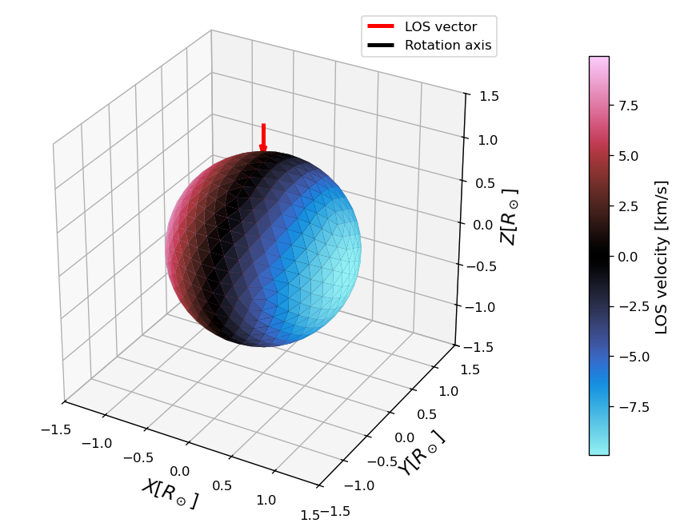

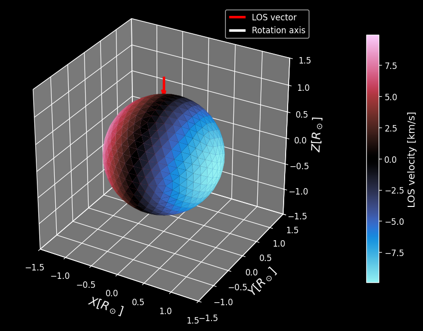

In this image, you can see the 3D structure of the mesh, with colors representing the 'los_velocities' values. The red arrow indicates the line of sight, and the black arrow shows the rotation axis.

You can customize the visualization by changing the `property` parameter. For example, you could use 'los_velocities' to color the mesh by line-of-sight velocities, or 'mus' to show the angle between the normal and the line of sight.

Adding Pulsation
----------------

To add pulsation to your model, you can use the `add_pulsation()` function:

.. code-block:: python

    from spice.models.mesh_transform import add_pulsation, evaluate_pulsations

    # Add pulsation to the model
    mp = add_pulsation(
        m, # Model instance
        1, # m order
        1, # l degree
        100., # pulsation period
        jnp.array([[0.5, 0.]]) # Fourier series parameters
    )

    t = 40. # time in days, the same unit as the pulsation period

    # To get the pulsated mesh at a specific time:
    pulsated_mesh = evaluate_pulsations(mp, t)  # t is the time

The pulsation period and the time passed to ``evaluate_pulsations`` are in days: the conversion of pulsation velocities to km/s assumes solRad/day.

The pulsation amplitude is given by the fourier series parameters. It can be calculated using the following function:

.. math::

   A = D + \sum_{n=1}^N A_n \cos\left(\frac{2\pi n}{P}t - \phi_n\right)

where :math:`D` is the mean amplitude, :math:`A_n` are the amplitudes, :math:`\phi_n` are the phases, and :math:`P` is the pulsation period.
The amplitude is a fraction of the reference stellar radius: 0.1 means 10%.

The Fourier series parameters are provided either as a 2D array with shape (N, 2) — interpreted as a purely radial pulsation — or as a full (3, N, 2) array whose first axis indexes the [radial, spheroidal, toroidal] vector-spherical-harmonic components. N is the number of terms in the series, and each innermost pair contains [A_n, phi_n], where A_n is the amplitude and phi_n is the phase for the nth term. For example, [[0.1, 0.0], [0.05, 1.57]] represents a radial series with two terms: the first with amplitude 0.1 and phase 0, and the second with amplitude 0.05 and phase π/2.
SPICE sums the displacement from all modes before calculating area changes.
The stored areas remain normalized by the reference radius squared. Face
sample centers move by the mean displacement of their triangle's vertices;
zero displacement preserves their original positions and the atmosphere
gravity. ``reset_pulsations`` removes both displacement and pulsation velocity.

This example pulsation will look like this:

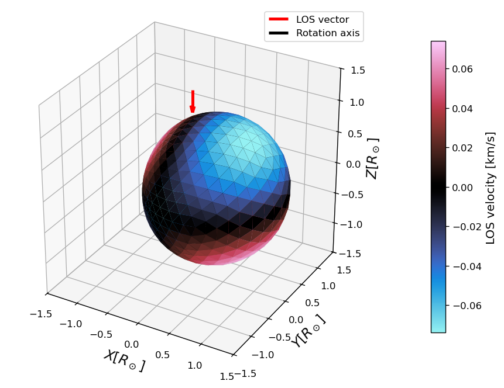

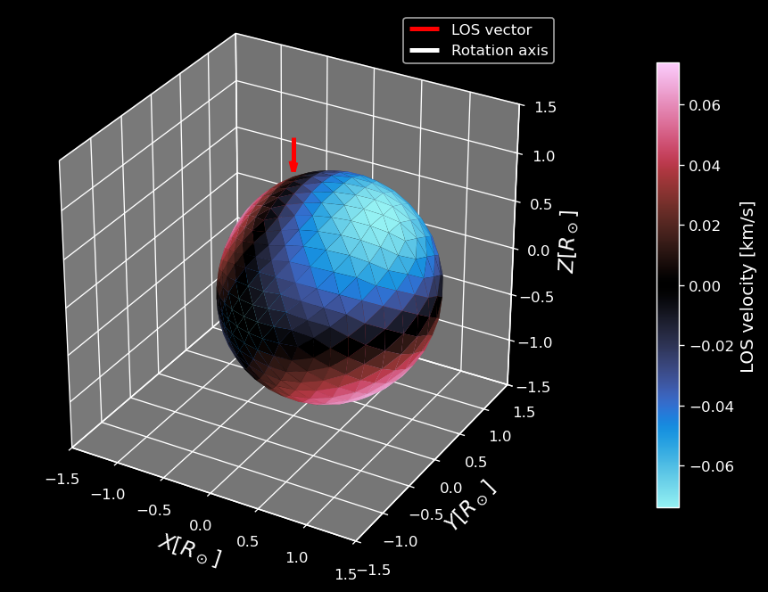

Of course, this is a highly unrealistic, exaggarated pulsation, but it shows the effect of pulsation on the mesh.

Travelling (prograde and retrograde) modes
^^^^^^^^^^^^^^^^^^^^^^^^^^^^^^^^^^^^^^^^^^

By default a mode with :math:`m \neq 0` is a *standing* wave: the real part of
:math:`Y_l^m` with fixed nodal lines, whose amplitude oscillates in time. Real
non-radial modes travel in longitude, which is what produces moving bumps in
line profiles. Pass ``travelling="prograde"`` (in the direction the star spins)
or ``"retrograde"``:

.. code-block:: python

    from spice.models.mesh_transform import add_rotation, add_pulsation, evaluate_pulsations

    m = add_rotation(m, 60.)            # add rotation first: modes use its axis
    m = add_pulsation(
        m, 4, 4, 0.2,                   # m = 4, l = 4, period 0.2 d
        jnp.array([[[0.01, 0.]], [[0.01, 0.]], [[0., 0.]]]),
        travelling="prograde",
    )
    snapshot = evaluate_pulsations(m, 0.05)

A travelling mode is :math:`\mathrm{Re}[Y_l^m e^{\mp i\omega t}]` for each
Fourier harmonic: the pattern keeps its shape and its peak displacement
(the amplitude) and moves at :math:`\omega/m` in longitude about the mode axis.
The frequency is in the frame of the stellar surface: evaluating pulsations
before ``evaluate_rotation`` adds the rotation on top. Travelling modes need
:math:`m > 0`. For an equator-on star, prograde bumps cross the line profile
from blue to red and retrograde bumps from red to blue.

Tilted Pulsation Axis
^^^^^^^^^^^^^^^^^^^^^

Pulsation modes are symmetric about the star's rotation axis by default. You can also define pulsations with an axis different from the rotation axis. This is done by specifying the `pulsation_axes` and `pulsation_angles` parameters in the `add_pulsation()` function:

.. code-block:: python

    from spice.models.mesh_transform import add_pulsation, evaluate_pulsations
    import jax.numpy as jnp

    # Create a basic model (assuming 'm' is already defined)
    
    # Add a tilted pulsation
    tilted_m = add_pulsation(
        m,  # Model instance
        0,  # m order
        1,  # l degree
        2.,  # pulsation period
        jnp.array([[1e-1, 0.]]),  # Fourier series parameters
        pulsation_axes=jnp.array([1., 0., 0.]),  # Tilt axis, perpendicular to the default +y rotation axis
        pulsation_angles=jnp.array([45.])  # Tilt angle in degrees
    )

    # Evaluate the pulsation at a specific time
    t = 0.5  # time in the same unit as the pulsation period
    tilted_pulsated_m = evaluate_pulsations(tilted_m, t)

This will create a pulsation whose symmetry axis is the rotation axis tilted by 45 degrees around the x-axis. You can visualize the difference between an untilted and tilted pulsation:

.. code-block:: python

    from spice.plots.plot_mesh import plot_3D
    import matplotlib.pyplot as plt

    # Create an untilted pulsation for comparison
    m = IcosphereModel.construct(1000, 1., 1.,
                                bb.to_parameters(), bb.parameter_names)
    untilted_m = add_pulsation(m, 0, 1, 2., jnp.array([[1e-1, 0.]]))
    tilted_m = add_pulsation(m, 0, 1, 2., jnp.array([[1e-1, 0.]]), pulsation_axes=jnp.array([1., 0., 0.]), pulsation_angles=jnp.array([45.]))

    untilted_pulsated_m = evaluate_pulsations(untilted_m, 0.5)
    tilted_pulsated_m = evaluate_pulsations(tilted_m, 0.5)

    fig, (ax1, ax2) = plt.subplots(1, 2, figsize=(20, 10), subplot_kw={'projection': '3d'})

    plot_3D(untilted_pulsated_m, property='los_velocities', axes=(fig, ax1))
    ax1.set_title('Untilted Pulsation')

    plot_3D(tilted_pulsated_m, property='los_velocities', axes=(fig, ax2))
    ax2.set_title('Tilted Pulsation')

    plt.tight_layout()
    plt.show()

This will produce a visualization showing the difference between untilted and tilted pulsations:

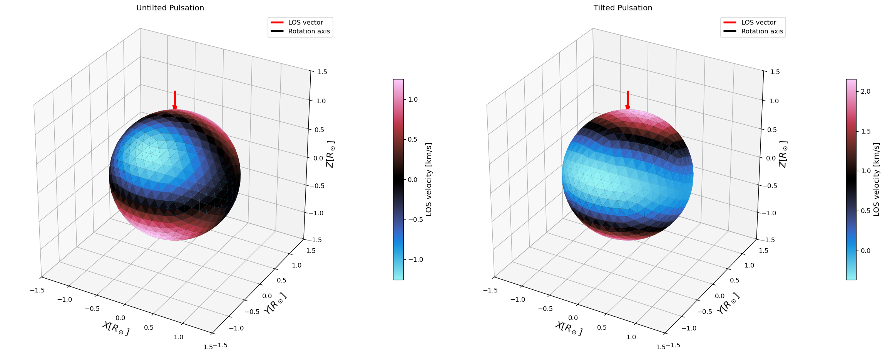

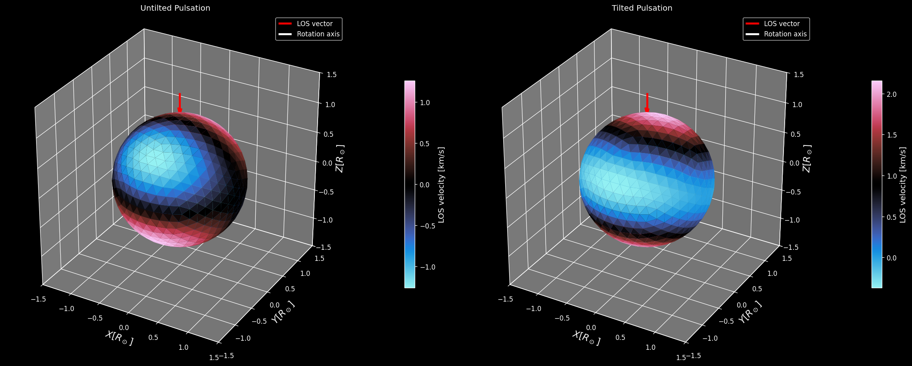

Adding Temperature Spots
------------------------

You can add temperature spots to your model using spherical harmonics:

.. code-block:: python

    from spice.models.spots import add_spherical_harmonic_spot

    base_temp = 5700
    spot_temp = 15000

    # Add temperature spots
    m_harm_spot = add_spherical_harmonic_spot(
        m, # Model instance
        4, # m order
        4, # l degree
        param_delta=9300, # difference in the parameter value between the spot and the background
        param_index=0 # index of the parameter in the parameters array
    )

which should produce a temperature map like this:

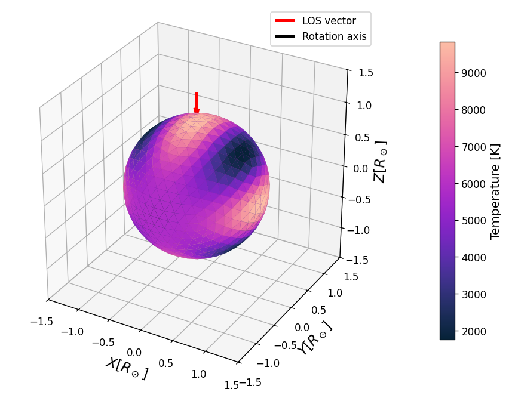

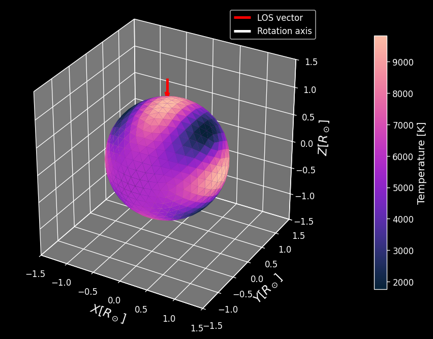

Similarly to pulsation, you can tilt the spot by specifying the `tilt_axis` and `tilt_angle` parameters:

.. code-block:: python

    m_harm_spot_tilted = add_spherical_harmonic_spot(
        m, # Model instance
        4, # m order
        4, # l degree
        param_delta=9300, # difference in the parameter value between the spot and the background
        param_index=0, # index of the parameter in the parameters array
        tilt_axis=jnp.array([0., 1., 0.]),
        tilt_angle=45.  # tilt angle in degrees
    )

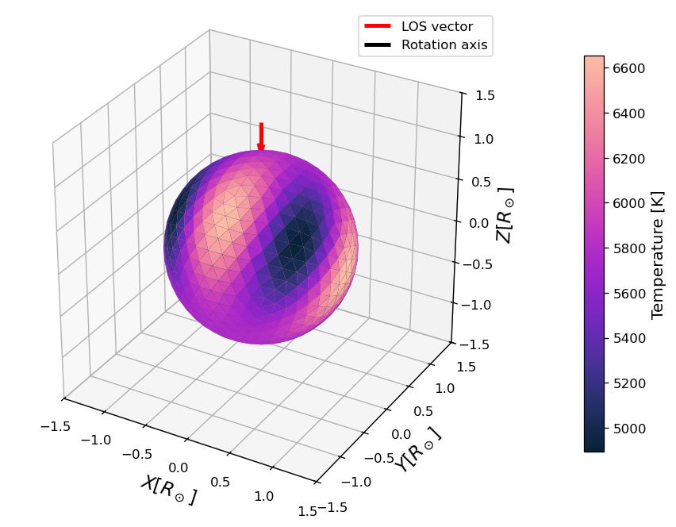

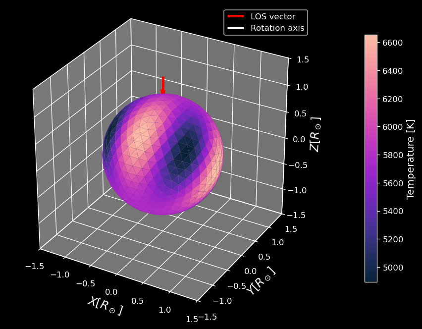

or add it as a circular spot:

.. code-block:: python

    from spice.models.spots import add_spot

    m_spot = add_spot(
        mesh=m, # Model instance
        spot_center_theta=0.5, # spot center in spherical coordinates, in radians
        spot_center_phi=0.5, # spot center in spherical coordinates, in radians
        spot_radius=50., # spot radius in degrees
        parameter_delta=1000, # difference in the parameter value between the spot and the background
        parameter_index=0, # index of the parameter in the parameters array
        smoothness=0.1 # smoothness of the spot edges
    )

The smaller the ``smoothness`` value, the sharper the spot edge: ``0.0`` (the default) gives the sharpest transition, and larger values up to ``1.0`` produce an increasingly gradual edge.

which should produce a temperature map like this:

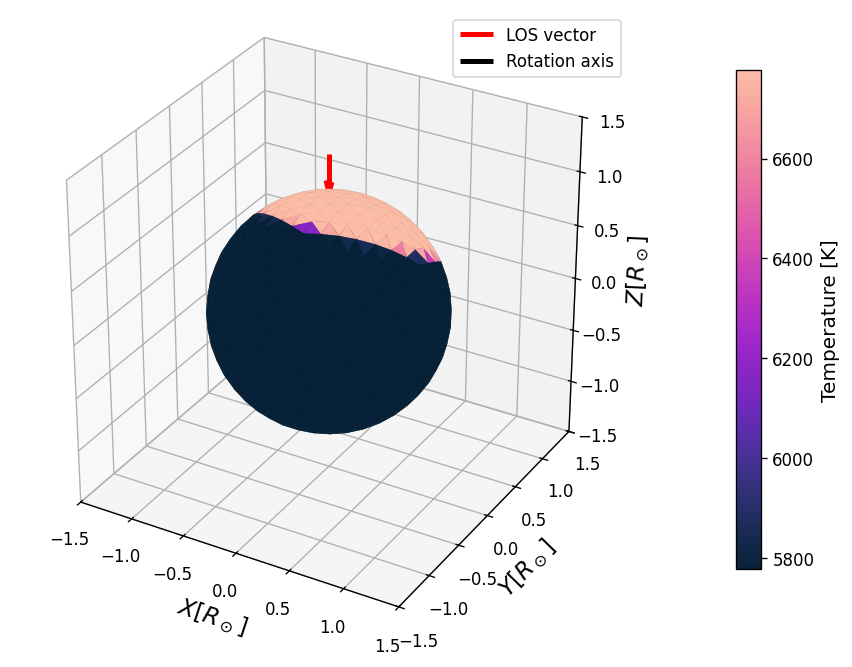

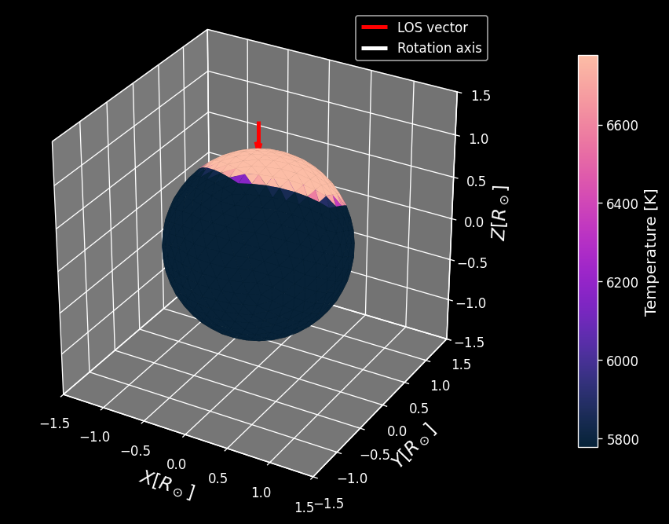

In both cases, you can also add multiple spots to the mesh. Either by adding two spherical harmonic modes:

.. code-block:: python

    from spice.models.spots import add_spherical_harmonic_spots

    m_harm_spots = add_spherical_harmonic_spots(
        mesh=m,
        m_orders=jnp.array([2, 3.]),
        n_degrees=jnp.array([2, 3.]),
        param_deltas=jnp.array([1000, 1000.]),
        param_indices=jnp.array([0, 0])
    )

which will produce a temperature map like this:

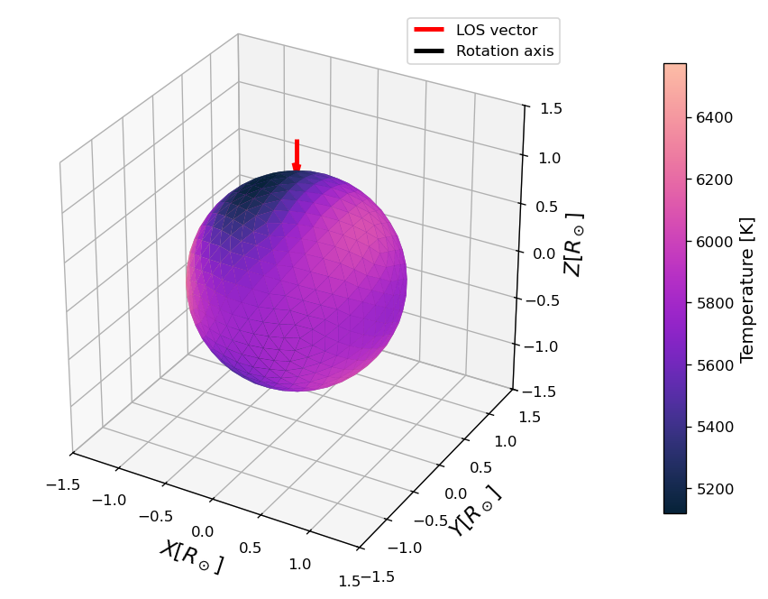

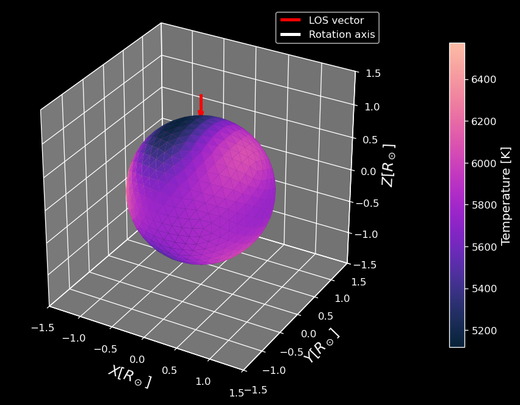

A comparison of two separate harmonic modes:

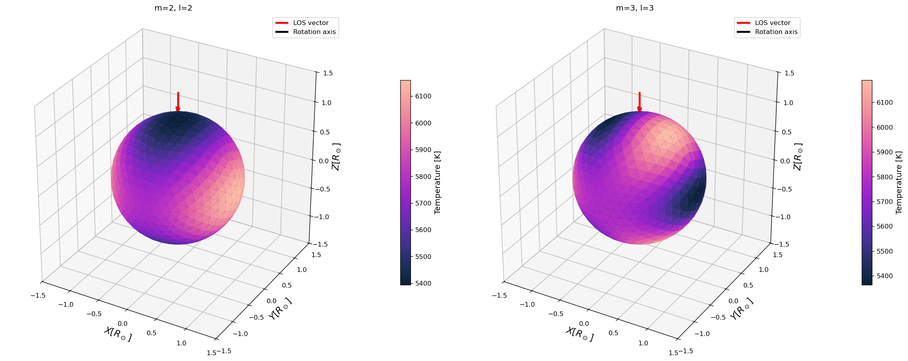

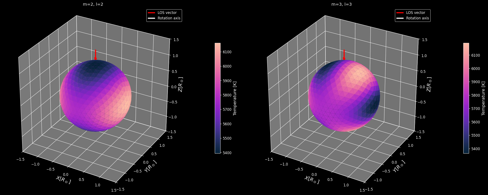

or by adding two circular spots:

.. code-block:: python

    from spice.models.spots import add_spots

    m_spots = add_spots(
        mesh=m, # Model instance
        spot_center_thetas=jnp.array([0.5, 1.5]), # spot center in spherical coordinates, in radians
        spot_center_phis=jnp.array([0.5, 0.]), # spot center in spherical coordinates, in radians
        spot_radii=jnp.array([20., 20.]), # spot radius in degrees
        parameter_deltas=jnp.array([1000., 1000.]), # difference in the parameter value between the spot and the background
        parameter_indices=jnp.array([0, 0]), # index of the parameter in the parameters array
        smoothness=jnp.array([0.5, 0.5]) # smoothness of the spot edges
    )

This example adds two spots to the mesh. The spots are defined by their center in spherical coordinates, their radius, and a differential parameter that quantifies the change induced by the spot.

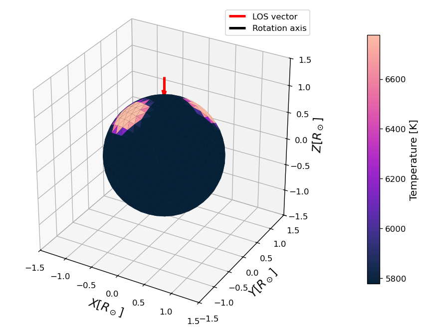

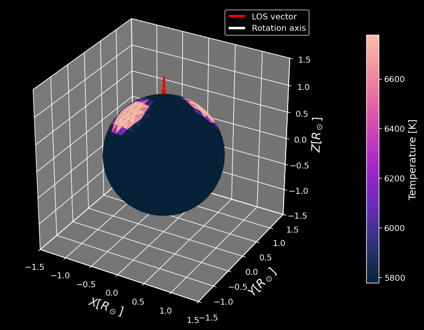
