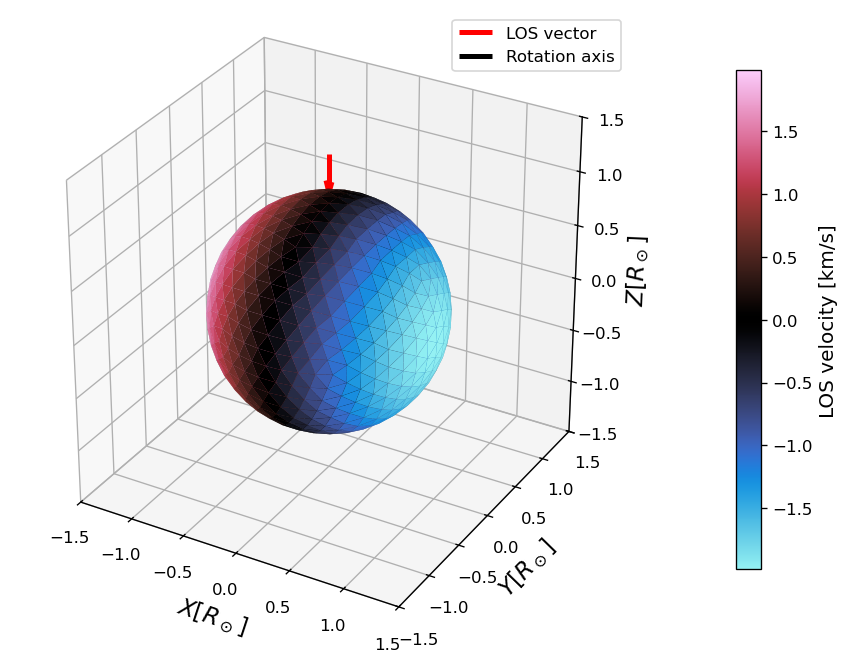
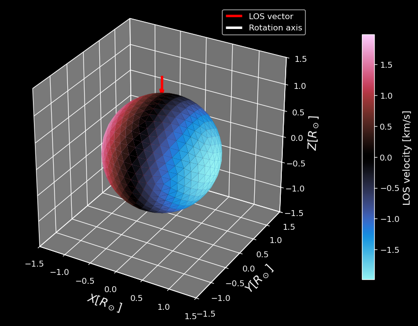
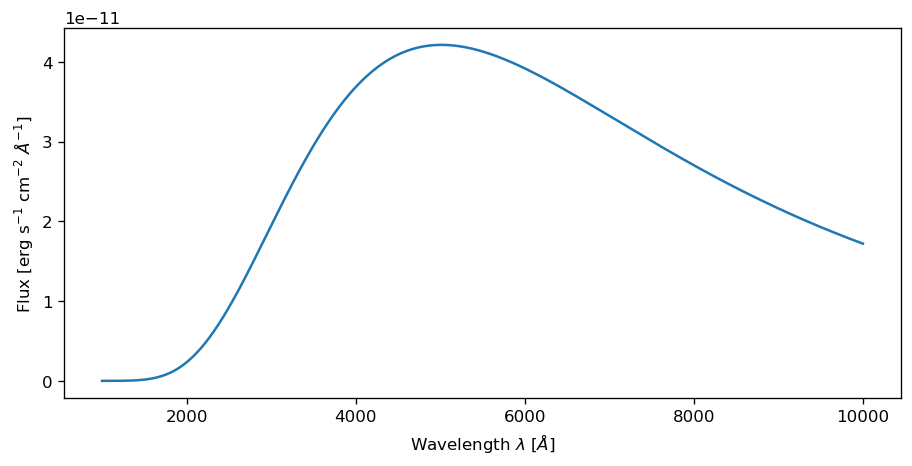
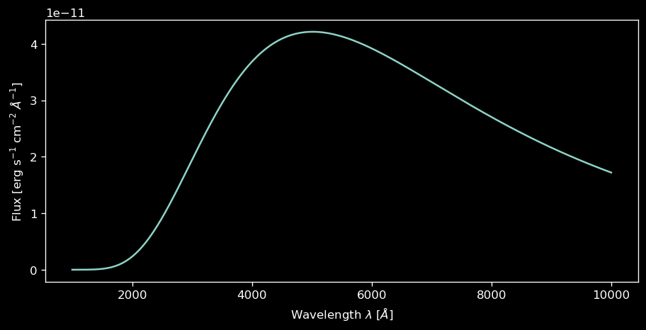
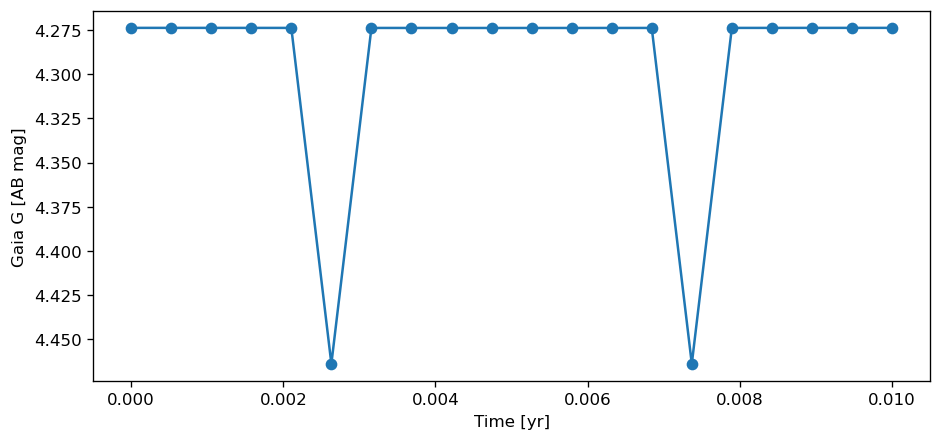
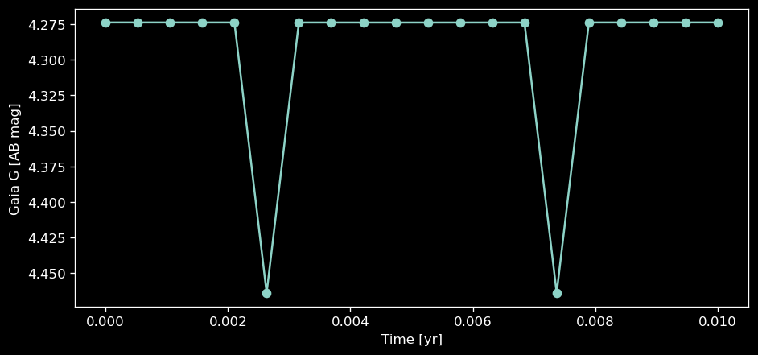

Quickstart
==========

This page walks through the two most common workflows end to end: a single
rotating star and an eclipsing binary. Both run with the core install only.

.. note::

   Every code snippet and figure on this page has a matching section in the companion notebook
   `tutorial/docs_examples/quickstart.ipynb <https://github.com/maja-jablonska/spice/blob/main/tutorial/docs_examples/quickstart.ipynb>`_;
   running it end-to-end regenerates all figures below.

A single rotating star
----------------------

.. code-block:: python

    import numpy as np
    from spice.models import IcosphereModel
    from spice.models.mesh_transform import add_rotation, evaluate_rotation
    from spice.spectrum import simulate_observed_flux, Blackbody

    bb = Blackbody()

    # A solar-like star: ~1000 mesh vertices, 1 solar radius, 1 solar mass
    star = IcosphereModel.construct(1000, 1., 1., bb.solar_parameters, bb.parameter_names)

    # Solid-body rotation with a 2 km/s equatorial velocity, evaluated at t = 0 s
    star = evaluate_rotation(add_rotation(star, rotation_velocity=2.0), 0.)

    # simulate_observed_flux expects *log10* wavelengths (in Angstroms) and
    # returns an (n_wavelengths, 2) array; column 0 is the flux in
    # erg/s/cm^2/Angstrom at the default distance of 10 pc.
    wavelengths = np.logspace(3, 4, 1000)  # 1,000-10,000 Angstroms
    flux = simulate_observed_flux(bb.intensity, star, np.log10(wavelengths))

The mesh carries the rotation as per-element line-of-sight velocities:

and the synthesized spectrum is a blackbody continuum over the requested
wavelength range:

Three things to remember (all covered in detail in :doc:`conventions` and
:doc:`spectral_synthesis`):

- wavelengths are passed as ``log10`` of Angstroms;
- the result has two columns — flux and the emulator's second channel
  (continuum for grid interpolators);
- the mesh, not the emulator, carries all geometry: rotation, pulsations,
  spots, and orbits are applied to the :class:`~spice.models.MeshModel`.

An eclipsing binary with a light curve
--------------------------------------

.. code-block:: python

    import numpy as np
    import jax.numpy as jnp
    from spice.models import IcosphereModel, Binary
    from spice.models.binary import add_orbit, evaluate_orbit_at_times
    from spice.models.mesh_view import get_mesh_view
    from spice.spectrum import simulate_observed_flux, Blackbody, AB_passband_luminosity
    from spice.spectrum.filter import GaiaG

    bb = Blackbody()
    los = jnp.array([0.0, 0.0, -1.0])  # line of sight (observer -> star)

    # Cast each component to the line of sight so occlusions can be resolved
    primary = get_mesh_view(
        IcosphereModel.construct(1000, 1.0, 1.0, bb.solar_parameters, bb.parameter_names), los)
    secondary = get_mesh_view(
        IcosphereModel.construct(1000, 0.8, 0.8, bb.solar_parameters, bb.parameter_names), los)

    binary = Binary.from_bodies(primary, secondary)

    # A close, edge-on system (P ~ 3.65 days) so the components actually eclipse
    binary = add_orbit(
        binary,
        P=0.01,                   # orbital period [years]
        ecc=0.0,                  # eccentricity
        T=0.0,                    # time of periastron passage [years]
        i=np.pi / 2,              # inclination [rad], edge-on
        omega=0.0,                # argument of periastron [rad]
        Omega=0.0,                # longitude of the ascending node [rad]
        mean_anomaly=0.0,         # additive phase offset from periastron timing [rad]
        reference_time=0.0,       # reference time [years]
        vgamma=0.0,               # systemic velocity [km/s]
        orbit_resolution_points=20,
    )

    # Evaluate the orbit across one period (eclipses/occlusions resolved internally).
    # Each time step resolves occlusions between two ~1000-vertex meshes; on a
    # laptop CPU these 20 steps take several minutes.
    times = jnp.linspace(0.0, 0.01, 20)
    primaries, secondaries = evaluate_orbit_at_times(binary, times)

    # Combined Gaia G-band light curve
    wavelengths = np.linspace(900, 40000, 500)
    gaia_g = GaiaG()
    light_curve = [
        AB_passband_luminosity(
            gaia_g,
            wavelengths,
            simulate_observed_flux(bb.intensity, p1, np.log10(wavelengths))[:, 0]
            + simulate_observed_flux(bb.intensity, p2, np.log10(wavelengths))[:, 0],
        )
        for p1, p2 in zip(primaries, secondaries)
    ]

The two eclipses show up as dips in the light curve: at phase 0.25 the
secondary transits the primary, and at phase 0.75 the larger primary hides
the secondary completely (total eclipse). With equal temperatures both dips
have the same depth:

Locating the eclipses
^^^^^^^^^^^^^^^^^^^^^

Rather than sampling the whole orbit densely, locate the eclipse windows
first with :func:`~spice.models.find_binary_eclipses` — it samples a
low-resolution orbit itself from the binary's orbital elements — and
concentrate the synthesis time points there:

.. code-block:: python

    from spice.models import find_binary_eclipses

    eclipses = find_binary_eclipses(binary)   # scans one period by default
    for e in eclipses:
        print(e['kind'], e['T1'], e['mid'], e['T4'])   # times in years

    # Densely sample the first eclipse window only
    dense = jnp.linspace(eclipses[0]['T1'], eclipses[0]['T4'], 10)
    primaries, secondaries = evaluate_orbit_at_times(binary, dense)

For the system above this finds two eclipses per period, at phases 0.25 and
0.75. Both are reported with ``kind='total'``: the label only says that the
smaller disc lies entirely inside the larger one, not which star is in front,
so the phase-0.25 event is physically a transit of the secondary.

See :doc:`binaries` for the full binary-modelling guide (including PHOEBE
import) and :doc:`synthetic_photometry` for the available filters and
magnitude systems.

Where to go next
----------------

- :doc:`mesh` — building meshes; rotation, pulsations, and spots
- :doc:`spectral_synthesis` — how flux synthesis works and its knobs
- :doc:`spectral_grids` — realistic spectra from precomputed atmosphere grids
- :doc:`custom_emulators` — plugging in your own spectrum model
