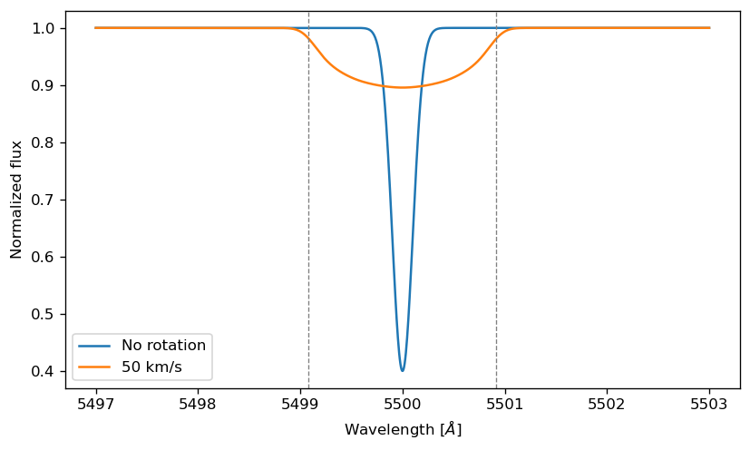
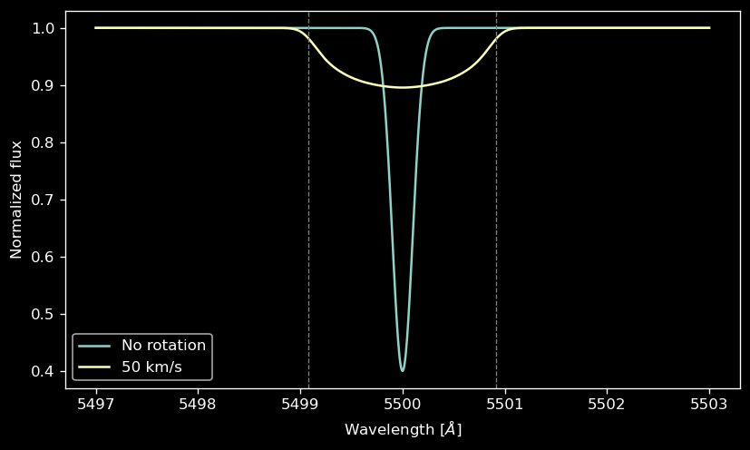
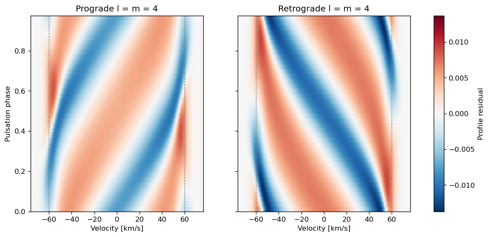
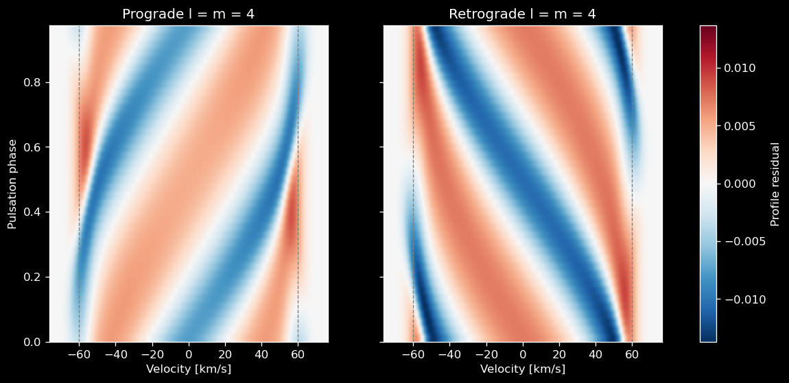

Spectral Synthesis
==================

:func:`~spice.spectrum.simulate_observed_flux` is SPICE's main entry point:
it turns a mesh model plus an emulator's intensity function into the
disc-integrated spectrum an observer would record.

.. note::

   The companion notebook contains additional synthesis examples:
   `tutorial/docs_examples/spectral_synthesis_examples.ipynb <https://github.com/maja-jablonska/spice/blob/main/tutorial/docs_examples/spectral_synthesis_examples.ipynb>`_.

How it works
------------

For every visible mesh element, SPICE:

1. evaluates the emulator's intensity at the element's parameters and viewing
   angle ``mu``,
2. Doppler-samples the rest-frame spectrum according to the element's
   line-of-sight velocity (rotation + pulsation + orbit),
3. weights by the element's visible, projected area, and
4. sums the contributions, scaled by :math:`1/d^2` for the distance.

The loop is chunked with ``jax.checkpoint`` so memory stays bounded for large
meshes and wavelength grids, and the whole computation is JIT-compiled.

Basic usage
-----------

.. code-block:: python

    import numpy as np
    from spice.models import IcosphereModel
    from spice.spectrum import simulate_observed_flux, Blackbody

    bb = Blackbody()
    star = IcosphereModel.construct(1000, 1., 1., bb.solar_parameters, bb.parameter_names)

    wavelengths = np.linspace(4000., 7000., 2000)   # Angstroms
    flux = simulate_observed_flux(bb.intensity, star, np.log10(wavelengths))

.. important::

   The wavelength argument is ``log10`` of the wavelength in Angstroms.
   Passing linear wavelengths is the most common mistake and produces
   silently wrong results.

The result has shape ``(n_wavelengths, 2)``: the disc-integrated versions of
the emulator's two output channels. For the grid interpolators these are
``[flux, continuum]`` — so ``flux[:, 0] / flux[:, 1]`` is the normalized
spectrum; :class:`~spice.spectrum.Blackbody` duplicates its intensity into
both columns. Units are erg/s/cm²/Å at the requested distance.

Parameters that matter
----------------------

``distance`` (float, parsecs, default 10.0)
    The flux scales as :math:`(R/d)^2`. The default 10 pc makes
    ``AB_passband_luminosity`` of the result an absolute magnitude.

``disable_doppler_shift`` (bool, default False)
    Skips the per-element Doppler sampling — useful for isolating geometric
    effects or speeding up static models.

``chunk_size`` (int, default 256)
    Surface elements evaluated together. Smaller chunks reduce memory use;
    larger values can increase compilation cost for neural emulators.

``wavelengths_chunk_size`` (int or None, default None)
    Defaults to ``min(n_wavelengths, 1024)``, avoiding padding short grids to
    1024 samples. Set an explicit size to control memory on long grids.

``ld_law`` / ``ld_coeffs``
    Bind a limb-darkening law into the intensity function (e.g.
    ``ld_law="linear"``, ``ld_coeffs=[0.5]``). The intensity function must
    accept these keywords, as the flux-emulator-based implementations do;
    passing them with one that does not, such as ``Blackbody().intensity``,
    raises ``TypeError``. :class:`~spice.spectrum.Blackbody` takes its LD
    configuration in its constructor instead
    (``Blackbody(ld_law="linear", ld_coeffs=[0.5])``).

Doppler shifts
--------------

Each element's ``los_velocity`` (negative = approaching, see
:doc:`conventions`) shifts its contribution: the rest-frame spectrum is
sampled at :math:`\lambda_{\mathrm{obs}} / (1 + v/c)`, so approaching
material imprints blueshifted features and a rotating star shows the
familiar line broadening. A blackbody has no lines to broaden, so this
example uses :class:`~spice.spectrum.GaussianLineEmulator`, a blackbody
continuum with Gaussian absorption lines that needs only the core install:

.. code-block:: python

    from spice.models.mesh_transform import add_rotation, evaluate_rotation
    from spice.spectrum import GaussianLineEmulator

    emu = GaussianLineEmulator(line_centers=[5500.], line_widths=[0.1], line_depths=[0.6])
    line_star = IcosphereModel.construct(1000, 1., 1., emu.to_parameters(), emu.parameter_names)
    line_wavelengths = np.linspace(5497., 5503., 1000)   # Angstroms

    flux_static = simulate_observed_flux(emu.intensity, line_star, np.log10(line_wavelengths))
    fast = evaluate_rotation(add_rotation(line_star, rotation_velocity=50.), 0.)
    flux_rot = simulate_observed_flux(emu.intensity, fast, np.log10(line_wavelengths))
    normalized_rot = flux_rot[:, 0] / flux_rot[:, 1]   # lines / continuum

At 50 km/s the line spreads to :math:`\pm v \sin i / c \times 5500` Å
:math:`\approx \pm 0.92` Å (dashed lines), and its equivalent width is unchanged.

Luminosities
------------

``simulate_monochromatic_luminosity`` integrates an emulator's surface flux
over the whole star and returns ``(n_wavelengths, 2)`` in erg/s/Å.
``luminosity`` integrates its first channel over the supplied **linear**
wavelengths in Angstroms and returns erg/s. The result covers only that
wavelength range; it approximates a bolometric luminosity only if the
range captures essentially all of the emitted energy.

The emulator must supply a true emergent surface flux,
:math:`F_\lambda = 2\pi\int_0^1 I_\lambda(\mu)\mu\,d\mu`.
``Blackbody.flux`` currently returns the intensity at ``mu=1``. For the
un-darkened ``bb = Blackbody()`` used above, multiply that intensity by
:math:`\pi` before using the luminosity functions:

.. code-block:: python

    from spice.spectrum import (simulate_monochromatic_luminosity,
                                luminosity, absolute_bol_luminosity)

    def surface_flux(log_wavelengths, parameters):
        return np.pi * bb.intensity(log_wavelengths, 1., parameters)

    lum_wavelengths = np.geomspace(100., 1.e6, 4096)  # Angstroms
    mono_lum = simulate_monochromatic_luminosity(
        surface_flux, star, np.log10(lum_wavelengths))  # erg/s/Angstrom
    L = luminosity(surface_flux, star, lum_wavelengths)  # erg/s
    M_bol = absolute_bol_luminosity(L)

No conversion to centimetres is needed for the integral. For a limb-darkened
intensity, integrate its angular dependence instead of multiplying its
``mu=1`` value by :math:`\pi`. Atmosphere emulators that already provide
surface flux should be passed directly, without another factor of :math:`\pi`.

Instrumental resolution
-----------------------

Use ``apply_spectral_resolution`` for a single resolving power, or
``apply_variable_resolution`` for an array of resolving powers on the same
uniform log10 wavelength grid:

.. code-block:: python

    import jax.numpy as jnp
    from spice.spectrum.utils import apply_variable_resolution

    log_wavelengths = jnp.linspace(jnp.log10(5460.), jnp.log10(5540.), 2001)
    flux_fast = simulate_observed_flux(emu.intensity, fast, log_wavelengths)
    resolving_power = jnp.linspace(20000., 30000., len(log_wavelengths))
    broadened = apply_variable_resolution(
        log_wavelengths, flux_fast[:, 0], resolving_power, segment_size=512)

These functions accept one spectrum channel at a time. Resolving power is
positive and defined by wavelength divided by Gaussian FWHM. The variable
function uses the mean resolving power within each segment, including a
shorter final segment. Adjacent segments share input spectrum samples for
convolution; only the spectrum's outer edges are padded with its global
mean. ``segment_size`` is a positive static integer under JIT. Smaller
segments track changes in resolving power more closely. Both functions
truncate Gaussian support at four sigma (the single-resolution function
also accepts ``window_size``). The kernel buffer is static under JIT: it
defaults to 2046 pixels per side and is widened automatically when the
wavelengths and resolving power are concrete. Inside your own ``jax.jit``
with a traced resolving power, a kernel wider than the buffer raises a
``RuntimeWarning``; pass a larger static ``max_half_width`` in that case.

.. _nonradial-lpv:

Line-profile variations of non-radial pulsations
------------------------------------------------

A travelling non-radial mode (see
:ref:`travelling-modes`) moves bumps across a
rotationally broadened line. Synthesising the line through one pulsation period
and subtracting the mean profile shows them as diagonal stripes: prograde bumps
cross the profile from blue to red, retrograde ones from red to blue. This is
the standard spectroscopic signature of the mode's azimuthal order and sense.

.. code-block:: python

    import numpy as np
    import jax.numpy as jnp
    from spice.models import IcosphereModel
    from spice.models.mesh_transform import add_rotation, add_pulsation, evaluate_pulsations
    from spice.spectrum import GaussianLineEmulator
    from spice.spectrum.spectrum import simulate_observed_flux

    emu = GaussianLineEmulator(line_centers=[5500.], line_widths=[0.05], line_depths=[0.6])
    star = IcosphereModel.construct(8000, 2.0, 1.5, emu.to_parameters(), emu.parameter_names)
    star = add_rotation(star, 60.)               # equator-on by default

    period = 0.2                                 # days
    wavelengths = jnp.linspace(5498.6, 5501.4, 600)
    mode = jnp.array([[[0.01, 0.]], [[0.01, 0.]], [[0., 0.]]])   # radial + horizontal
    phases = np.linspace(0., 1., 40, endpoint=False)

    def residual_spectra(travelling):
        model = add_pulsation(star, 4, 4, period, mode, travelling=travelling)
        profiles = []
        for phase in phases:
            flux = simulate_observed_flux(emu.intensity,
                                          evaluate_pulsations(model, phase * period),
                                          jnp.log10(wavelengths))
            profiles.append(np.asarray(flux[:, 0] / flux[:, 1]))
        profiles = np.array(profiles)
        return profiles - profiles.mean(axis=0)

    prograde = residual_spectra("prograde")
    retrograde = residual_spectra("retrograde")

The dashed lines mark :math:`\pm v \sin i`. The mode frequency is the one in
the frame of the stellar surface; to model an observed frequency in the
inertial frame, add the rotational term :math:`m\Omega` yourself (Coriolis
effects on the mode shape are not included).

Performance notes
-----------------

- The first call compiles; subsequent calls with the same shapes reuse the
  compiled kernel. Keep wavelength-grid and mesh sizes fixed inside loops.
- Chunk sizes are static arguments — changing them recompiles.
- For time series, prefer evaluating meshes first (e.g. with
  ``evaluate_rotation_at_times`` / ``evaluate_orbit_at_times``) and reusing
  one wavelength grid across all synthesis calls.
